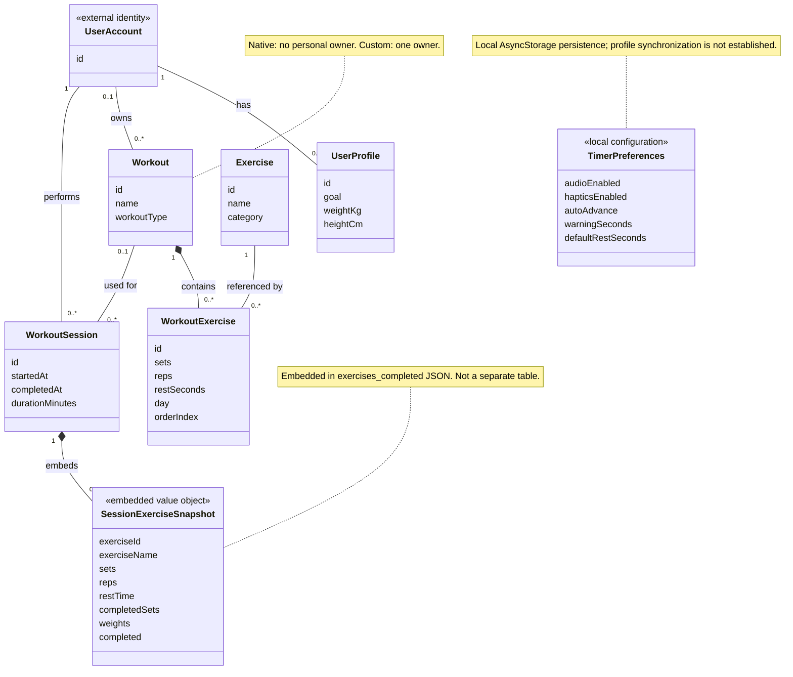

# Sprint 1 class model: source-checked proposal

Review date: 21 October 2026. Status: approved model applied. Target: the Sprint 1 domain diagram included at `main.tex:622`, plus the explanatory paragraph at `main.tex:617`. The replacement PNG and explanatory paragraph have been updated; an SVG and editable rendering source are included alongside the figure.

## Scope and evidence boundary

This model describes the Sprint 1 feature area using the current local implementation and matching SQL definitions/migrations. It does not establish the exact historical sprint-end version, which would require a nominated commit. SQL files establish declared schema intent; their presence does not prove that every migration is applied to the deployed database. Runtime tests and live database inspection are outside this review.

The model is conceptual, with explicit mappings to persistence. It is not a one-to-one inventory of tables or JavaScript classes. In particular, SessionExerciseSnapshot is a proposed descriptive domain name for the existing objects embedded in session JSON; it is not an implemented class or new table.

## Confirmed corrections to the earlier example

1. Separate UserAccount from UserProfile. Ownership columns in workouts and sessions refer to auth.users, while a user_profiles row has the same identity and may not exist yet. A profile is not required by these foreign keys.
2. Keep one Workout concept for native/custom workouts. Both the current service and unified schema support it. A native workout has no personal owner; a custom workout has one.
3. Keep WorkoutExercise. This is a real junction carrying sets, repetitions, rest time, day, and order. It is not merely an unqualified many-to-many line.
4. Add SessionExerciseSnapshot under WorkoutSession. Saved session entries carry their own exercise identifier/name, set and repetition configuration, rest time, completion array, weight array, and overall completion flag.
5. Remove the separate WorkoutSet entity from the implementation-oriented domain view. A later conceptual per-set projection is possible, but the source does not persist a collection of separately identified set objects. Do not suggest independent actual-repetition or RPE capture.
6. Remove the UserProfile–TimerPreferences ownership association. The current settings UI changes the timer store, which persists preferences locally in AsyncStorage under timer-storage. SQL also defines a nullable profile JSON column with defaults, but no reference to that column was found in the inspected mobile source. Its existence does not establish profile synchronization.
7. Remove AuthService, WorkoutService, and stores from this domain view. Explain those implemented application responsibilities in technical sequences instead.

## Class and attribute mapping

Only selected attributes are proposed for the figure. Optional fields remain optional in the full specification.

| Proposed concept | Selected attributes and source representation | Evidence |
|---|---|---|
| UserAccount, external identity | id: UUID; identity is managed by authentication, not a new GoFit table | `database/schema/create_user_profiles_table.sql:6`; `database/migrations/unify_workouts_design.sql:23`; `GoFitMobile/src/store/authStore.ts:15` |
| UserProfile | id: same UUID as account; goal: optional string; weightKg and heightCm: optional numeric values mapped to weight/height | `database/schema/create_user_profiles_table.sql:5`; `GoFitMobile/src/services/userProfile.ts:15`, `:95` |
| Workout | id: UUID; name: string; workoutType: native/custom; difficulty: optional stored value | `GoFitMobile/src/services/workouts.ts:33`; `database/migrations/unify_workouts_design.sql:21` |
| Exercise | id: UUID; name: string; category: string; equipment: optional collection of strings | `GoFitMobile/src/services/workouts.ts:4`; `database/schema/create_workouts_tables_normalized.sql:8` |
| WorkoutExercise | id: UUID; sets: integer; reps: textual prescription; restSeconds: integer; day: integer 1–7; orderIndex: integer | `database/migrations/unify_workouts_design.sql:189`; `database/migrations/add_workout_split_days.sql:8`; `GoFitMobile/src/services/workouts.ts:262` |
| WorkoutSession | id: UUID; startedAt: timestamp; completedAt: optional timestamp; durationMinutes: optional integer; notes: optional string | `GoFitMobile/src/services/workouts.ts:58`, `:726`, `:802`; `database/schema/create_workouts_tables_normalized.sql:240` plus later workout migrations |
| SessionExerciseSnapshot, embedded value object | exerciseId: copied string; exerciseName: string; sets/reps/restTime: strings; completedSets: boolean array; weights: array of numbers or null; completed: boolean | `GoFitMobile/src/screens/library/WorkoutSessionScreen.tsx:68`, `:329`, `:766` |
| TimerPreferences, local configuration value object | audioEnabled, hapticsEnabled, autoAdvance: boolean; warningSeconds: number array; defaultRestSeconds: number | `GoFitMobile/src/store/timerStore.ts:5`, `:29`, `:82`; `GoFitMobile/src/components/workout/RestTimerSettings.tsx:34` |

The final figure should not introduce email/role/fitnessLevel as direct profile attributes based on the old picture. Email belongs to the authentication identity; client/coach and admin distinctions must use their real representations when introduced in later views. No implemented RPE or target-load field was found in the inspected workout/session path.

Repetitions need particular care: workout_exercises.reps is declared as text and the read path preserves text, but the custom-workout write path uses parseInt(exercise.reps). Therefore the model can describe a textual prescription without claiming that every comma-separated prescription is preserved by every creation/editing path. That implementation issue is outside diagram correction scope.

## Every proposed relationship

| Relationship | Multiplicities | Justification and limits |
|---|---|---|
| UserAccount–UserProfile | Each profile belongs to 1 account; each account has 0..1 profile | Profile primary key is also an FK to auth.users. No inspected constraint requires a profile for every account. |
| UserAccount–Workout | Each workout has 0..1 personal owner; each account owns 0..* workouts | Unified native/custom representation. Additional rule: native ⇒ no owner; custom ⇒ one owner. |
| Workout–WorkoutExercise | Each entry belongs to 1 workout; each workout has 0..* entries | Non-null FK and delete cascade; schema and service permit creating an empty workout. Use composition for entry ownership. |
| Exercise–WorkoutExercise | Each entry references 1 exercise; each exercise appears in 0..* entries | Non-null exercise FK. An entry's day/order are needed to understand its placement. The split migration makes uniqueness per workout/day/exercise. |
| UserAccount–WorkoutSession | Each session belongs to 1 account; each account has 0..* sessions | Required session user_id references auth.users, not user_profiles. |
| Workout–WorkoutSession | Each session refers to 0..1 workout; each workout has 0..* sessions | createWorkoutSession explicitly permits absent workout_id; deletion rule is SET NULL. Use association, not composition, because sessions may survive workout deletion. |
| WorkoutSession–SessionExerciseSnapshot | Each embedded entry belongs to 1 session; each session has 0..* entries | exercises_completed is initialized to an empty array and later receives mapped exercise objects. Use composition to express embedded ownership. |
| TimerPreferences | No account/profile ownership line in this domain figure | Current persistence is one local timer store, not an evidenced per-account configuration. The separate box is intentionally unconnected; its use belongs in the timer technical sequence. |

Do not draw a mandatory SessionExerciseSnapshot–WorkoutExercise association: the snapshot records the exercise ID rather than the junction-entry ID, and sessions can originate from program-day data without a Workout row. Do not draw an enforced snapshot-to-Exercise FK either: it is embedded JSON, not a relational reference guaranteed by that schema.

## Proposed diagram

Attributes are abbreviated here to keep the review readable; nullability and full source mappings are specified above. The omissions do not remove other implemented fields.

## Proposed explanatory text for the report

> The Sprint 1 domain model distinguishes the authentication account from its optional fitness profile and represents the principal workout definitions and execution records. Native and custom workouts share a common Workout concept; only custom workouts have a personal owner. WorkoutExercise associates an exercise with its prescribed sets, repetitions, rest interval, day, and order. A WorkoutSession belongs to an account and may optionally reference a workout definition. Session exercise data are retained as embedded snapshots containing exercise information, completion flags, and recorded weights, rather than as independently persisted WorkoutSet entities. Rest-timer preferences are represented separately as local application configuration. Services, stores, and synchronization mechanisms are described in the technical interaction diagrams.

## Items deliberately not claimed

- That all SQL migrations have been applied remotely.
- That this current implementation is the exact Sprint 1 historical state.
- That profile-based timer synchronization works merely because a SQL column exists.
- That displayed repetition targets are independently recorded actual repetitions.
- That RPE, persisted set identities, target load, or every total-volume field in the old picture is supported by this execution path.
- That domain-owned snapshots are database tables or enforce foreign keys to mutable workout definitions.
- That offline completion guarantees entirely offline session creation or zero data loss.

## Approval boundary

The user approved proceeding with the account/profile split, embedded session-exercise representation, local timer-preference scope, and relationship multiplicities. Sprint 2 and Sprint 3 remain outside this correction batch. The source check supports this current-code model, not an unqualified claim of 100% correctness across historical or deployed versions.

## Applied correction and verification

- Replaced `figures/class_diagram_sprint1.png` with the approved eight-concept, seven-relationship model. The current simplified rendering is 2400 × 3000 pixels.
- Added `figures/class_diagram_sprint1.svg` and reproducible source `figures/source/build_sprint1_class_diagram.py`.
- Replaced only the domain-model explanatory paragraph at `main.tex:617`, including a clarification of optional profile measurements and ongoing-session completion data.
- Visually inspected the rendered PNG and adjusted the column gap so association multiplicities stay clear of class boxes. Parsed the SVG successfully.
- Compared the original project files against the supplied ZIP: only `main.tex` and the Sprint 1 class PNG differ. The LaTeX difference is confined to the approved paragraph. Other report diagrams remain unchanged.
- No application code, database state, or test results were changed. LaTeX compilation was not part of this content correction.
- Applied the user's diagram-style preference: plain white boxes, thin monochrome lines, consistent text, and no notation legend. Explanatory storage/ownership notes remain in the report paragraph and this review rather than adding prose inside the figure. Preserve this restrained style for subsequent diagrams.
- After restoration completed on 21 October 2026, read-only live schema inspection confirmed account/profile identity, workout ownership rules, optional workout references with ON DELETE SET NULL, split-day junction uniqueness, and session JSON storage. See `deployment-verification.md`. This supports the approved relationships without proving feature tests or the exact historical Sprint 1 state.
