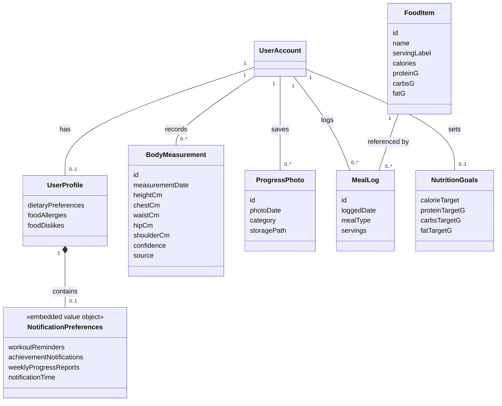

# Sprint 2 cumulative class model: source-checked proposal

Review date: 21 October 2026. Status: approved model applied after local-source and healthy-state deployed-schema checks. The Sprint 2 explanation, cumulative-view figure structure, extension PNG, and caption have been updated.

## Baseline and scope

Retain all eight approved Sprint 1 concepts and their seven relationships: UserAccount, UserProfile, Workout, Exercise, WorkoutExercise, WorkoutSession, SessionExerciseSnapshot, and TimerPreferences. Preserve optional personal workout ownership, optional workout references from sessions, embedded session snapshots, and unconnected local timer configuration. Extend UserProfile with its implemented dietary fields; do not move ownership references from authentication accounts to profiles.

Add six concepts for the principal measurement, progress-photo, nutrition, and notification-preference requirements described in Sprint 2. This is a selected cumulative domain view, not an exhaustive database schema. Reusable saved meals, water intake records, wearable data, and every notification-inbox object are not included in this proposed view. These exist in the current repository but should not be silently assigned to a historical sprint simply because their source exists today. They can be modeled in a supplementary view if that scope is required.

This check establishes current local code behavior and declared SQL structure, supplemented by healthy-state live schema verification. It does not establish a historical sprint-end commit, measurement accuracy, notification delivery, or successful end-to-end testing.

Remote-check follow-up: `deployment-verification.md` records the initial inconclusive restoration observations and a subsequent ACTIVE_HEALTHY check on 21 October 2026. The live database has 40 public tables and 60 recorded migrations. The five new persisted concepts and profile configuration fields are present. Their account/food foreign keys and the nutrition_goals primary key confirm the proposed multiplicities. The full migration inventory and schema metadata are saved in `deployed-migration-inventory.md` and `deployed-schema-check.json`. All six proposed additions now have supporting live schema evidence; exact execution history for every local SQL script remains unproven.

## New concepts, selected fields, and evidence

| Concept | Selected domain fields | Source mapping |
|---|---|---|
| BodyMeasurement | id, measurementDate, heightCm, chestCm, waistCm, hipCm, shoulderCm, confidence, source, manualOverrides | `database/migrations/create_body_measurements.sql:2` defines identity/account/date/metadata; `add_body_measurement_ondevice_columns.sql:2` adds centimeter/confidence fields; `add_body_measurement_height_cm.sql:2` adds height; `GoFitMobile/src/screens/profile/BodyMeasurementScreen.tsx:454` writes corrected values, source ai_ondevice, and original estimates/correction metadata. Measurement date is supplied by the schema default when not sent by this save handler. |
| ProgressPhoto | id, photoDate, category, storagePath, note | `database/migrations/create_progress_photos_v1.sql:4`; `GoFitMobile/src/services/progressPhotos.ts:11`, `:88`. Each row describes one uploaded image. Signed URLs are generated for access and are not the stored photo identity. |
| FoodItem | id, name, servingLabel, calories, proteinG, carbsG, fatG, barcode | `database/migrations/create_nutrition_tracking.sql:2`; `GoFitMobile/src/services/nutrition.ts:6`. Barcode is optional; additional attribution/fiber fields exist but need not all appear in this selected view. Nutrients describe the food's serving basis, not a particular user's daily consumption. |
| MealLog | id, loggedDate, mealType, servings | `database/migrations/create_nutrition_tracking.sql:24`; `GoFitMobile/src/services/nutrition.ts:512`. Each row references one food item and one account. Daily totals are calculated from food nutrients multiplied by servings. |
| NutritionGoals | calorieTarget, proteinTargetG, carbsTargetG, fatTargetG | `database/migrations/create_nutrition_tracking.sql:15`; `GoFitMobile/src/services/nutrition.ts:330`, `:359`. The user ID is the primary key; there is no independent goals UUID. Fiber/water targets are later declared extensions in `extend_nutrition_water_fiber_v1.sql` and used in the current service; these should be identified explicitly if included in the figure. |
| NotificationPreferences, embedded value object | workoutReminders, achievementNotifications, weeklyProgressReports, notificationTime, inactivityNudges, inactivityThresholdDays, streakAlerts | `database/migrations/add_notification_preferences_column.sql` declares the JSON column; `GoFitMobile/src/services/userProfile.ts:31`, `:302`; `GoFitMobile/src/screens/profile/NotificationsSettingsScreen.tsx:360` saves preferences before attempting local scheduling. This does not guarantee delivery. |

Field labels are domain-friendly aliases, not invented columns. For example, confidence maps to measurement_confidence and hipCm maps to hip_cm. Selected numeric measurement fields may be null in the schema; the current AI-save handler supplies the reviewed values. A separate weightKg attribute is not justified for this on-device measurement record. Current bodyweight remains represented on UserProfile in this view.

## Extended UserProfile fields

Add dietaryPreferences, foodAllergies, and foodDislikes as optional/possibly empty string collections. The SQL columns are nullable with empty-array defaults; do not depict them as independently persisted entities with UUIDs.

Evidence: `database/migrations/add_user_dietary_preferences_v1.sql:2`; `GoFitMobile/src/services/userProfile.ts:43`, `:307`. `GoFitMobile/src/screens/nutrition/AddFoodScreen.tsx:95` passes allergies/dislikes into food search. The search implements name-based exclusions (`GoFitMobile/src/services/nutrition.ts:115`), not a certified ingredient-allergen safety mechanism. No class relationship should imply verified allergen detection from barcode metadata.

## New relationship checks

| Relationship | Multiplicities | Evidence and reasoning |
|---|---|---|
| UserAccount–BodyMeasurement | Account 1; measurements 0..* | Required body_measurements.user_id FK references auth.users. No relationship requires a progress-photo record. |
| UserAccount–ProgressPhoto | Account 1; photos 0..* | Required progress_photos.user_id FK references auth.users. Photo records have their own dates and categories. |
| UserAccount–MealLog | Account 1; meal logs 0..* | Required meal_logs.user_id FK. Each account can log the same food repeatedly. |
| FoodItem–MealLog | Food item 1; meal logs 0..* | Required food_item_id FK, ON DELETE RESTRICT. Use association, not composition: a food item is shared catalog data. |
| UserAccount–NutritionGoals | Account 1; goals 0..1 | nutrition_goals.user_id is both a primary key and required account FK. getOrCreateGoals handles absence; opening the app does not prove every account has a record. |
| UserProfile–NotificationPreferences | Profile 1; configuration 0..1 | Preferences are an optional JSON value embedded in the profile; use composition to describe ownership. Defaults do not make the nullable database field mandatory. |

Use ordinary associations for account-owned records in this view, consistent with Sprint 1. The optional embedded NotificationPreferences object has no independent ID. The resulting model contains 14 concepts and 13 relationships, including the entire Sprint 1 baseline.

## Removed or reinterpreted concepts from the old Sprint 2 image

- **MeasurementPhoto:** remove the persistent-looking class and the mandatory one-or-two-photos association. The on-device measurement save handler inserts values and correction metadata without uploading captured photos. Uploaded progress photos are a separate feature and have no inspected measurement foreign key.
- **MetricProgress:** remove as a purported generic persisted entity. Training statistics are calculated from sessions by `GoFitMobile/src/services/workoutStats.ts:181` and its processing functions. Do not infer a longitudinal bodyweight database merely from a profile weight field.
- **NutritionEntry:** replace with MealLog plus FoodItem. Meal logs do not duplicate a full food's nutrients as the old figure suggests.
- **DietaryPreference:** replace with actual profile collections and separate per-account NutritionGoals. Avoid inventing an extra table or requiring every account to have a profile/goal record.
- **MeasurementService and NutritionService:** omit from this domain view, following the approved Sprint 1 convention. Show their responsibilities in technical sequences.
- **isVerified:** omit as an implemented measurement field. User review/correction does not establish accuracy against tape measurements.

## Adaptive recommendations and progress calculations

US-4.4 is not being ignored: `GoFitMobile/src/services/workoutRecommendations.ts:17` defines a transient AIWorkoutRecommendation response. `GoFitMobile/src/components/home/RecommendedWorkouts.tsx:44` saves an accepted recommendation through the existing createCustomWorkout operation. Therefore the persisted result is already represented by Workout and WorkoutExercise. No independent AI-generated-workout table or fixed one-to-one recommendation-to-workout relationship is supported. Illustrate the generation/acceptance interaction in the technical sequence and use case diagrams.

Likewise, charts and daily totals do not require invented persistent metric entities. Document their calculation dependencies in the surrounding text or a dedicated derived-view diagram. This proposal makes no claim that every statistical result or UI chart is validated.

## Proposed extension view for approval

This view shows only additions and their account/profile anchors. It is not the complete cumulative replacement: the final model must also retain all eight Sprint 1 concepts and seven relationships.

## Proposed report paragraph

> The Sprint 2 domain model extends the Sprint 1 foundation with body measurements, progress photos, food items, meal logs, nutrition goals, and embedded notification preferences. Each measurement record stores reviewed values and estimation metadata, while progress photos are independently stored user records; the model does not require a saved photo for each AI-assisted measurement. MealLog associates an account with a food item, date, meal category, and serving quantity, from which daily nutrient totals are calculated. Each account may have at most one NutritionGoals record. Dietary preferences, allergies, and dislikes extend the user profile rather than introducing independent entities. Notification preferences are optional profile configuration, distinct from the locally persisted rest-timer preferences. Training statistics are derived from session history, and accepted AI workout recommendations reuse the existing workout model. The figure presents the principal domain concepts and does not claim exhaustive coverage of every nutrition or notification feature.

## Approval and rendering plan

The user approved proceeding after reviewing the six additions, profile extensions, multiplicities, and deployed-schema findings. The cumulative model is presented as two complementary figures: an unchanged rendering of the eight-concept Sprint 1 foundation, followed by the extension view. The repeated UserAccount/UserProfile anchors refer to the same concepts in both views. Together the views contain 14 distinct concepts and 13 distinct relationships; the account/profile relationship is repeated for readability.

The report explicitly identifies both views and explains that the extension shows only the profile's new dietary fields, without removing its earlier attributes. Its existing fig:class_sprint2 label is preserved for the extension; fig:class_sprint2_foundation identifies the retained foundation.

The extension follows the user's preferred plain monochrome style, thin lines, consistent text, and absence of a notation legend. It is rendered at 2400 × 3150 pixels with an accompanying SVG and reproducible Python source in figures/source/build_sprint2_class_diagram.py. Visual inspection checked the class labels, connector endpoints, and multiplicities. SVG parsing and included-image existence checks passed. Other than the previously approved Sprint 1 changes, the original-project comparison shows changes only to the Sprint 2 PNG and its LaTeX section. Sprint 3 and all unrelated diagrams remain unchanged. LaTeX compilation was not part of this content correction.
